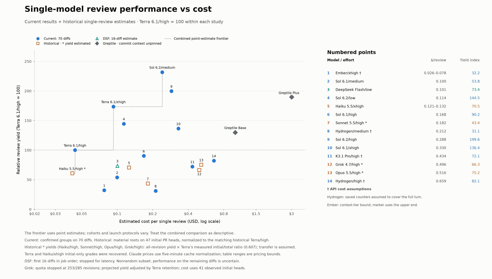

# Sol 6.2 high effort: medium remains the better solo value

On the same 70 diffs, **high did not extend the low-to-medium improvement**.
Fresh Opus 5.5/high judging gives medium **209.00** confirmed issues versus
**180.00** for high. High costs about **20% more** per review and takes about
**14 seconds longer** at the simulated corpus median.

High-impact yield changes only from **18.33 to 19.00**. The paired 95%
interval for that gain is **−0.67 to +2.33**, so this sample does not establish
a high-impact benefit. All 19 high-impact issues caught by high were already
caught by at least one of the three medium samples on their respective diffs.
The different launch protocol and single high sample limit effort-only inference.

## Findings, price and latency

Each row describes one reviewer per diff. Low and medium average their three
independent samples within each diff; high has one sample per diff. Counts
sum distinct Opus-confirmed groups across all 70 diffs. Plausible and rejected
groups do not count. All three efforts below use the fresh `verify10` judgments.

| Sol 6.2 effort | Samples per diff | Low impact | Medium impact | High impact | Medium + high | All confirmed | Time (s) | Mean $/review |
|---|---:|---:|---:|---:|---:|---:|---:|---:|
| low | 3 | 58.00 | 59.33 | 13.00 | 72.33 | 130.33 | 47.3 | $0.114 |
| medium | 3 | 93.67 | 97.00 | 18.33 | 115.33 | 209.00 | 109.7 | $0.241 |
| high | 1 | 68.00 | 93.00 | 19.00 | 112.00 | 180.00 | 123.8 | $0.288 |

Time is the mean of simulated corpus medians: sample one retained session for
each diff, take the median prompt-to-completion time across diffs, and average
4,000 assignments. It excludes session startup. For the single high sample,
it is simply the corpus median. High's observed p95 is **260.3 seconds**, and
its slowest review took **993.5 seconds**. Estimated API prices cover reviewer
turns, excluding judging, setup and subscription charges. They use the study's
existing pricing assumptions, rather than a new current-price survey.

[Exact solo counts and measured usage](solo-summary.json) ·
[All configurations, including partial DSF](solo-severity-totals.csv) ·
[Per-diff Sol 6.2 counts](sol62-per-diff.csv)

## Paired comparisons

These are 20,000 paired bootstrap resamples over the same 70 diffs. The
intervals describe this observed cohort and do not estimate repeated-high
sampling variance or remove the protocol/runtime confounds.

| Change | All confirmed, gain (95% interval) | Medium + high, gain (95% interval) | High impact, gain (95% interval) |
|---|---:|---:|---:|
| Low → medium | +78.67 (+60.33 to +98.00) | +43.00 (+29.00 to +59.00) | +5.33 (+1.67 to +9.67) |
| Medium → high | −29.00 (−49.33 to −10.00) | −3.33 (−14.67 to +6.67) | +0.67 (−0.67 to +2.33) |
| Low → high | +49.67 (+29.33 to +69.67) | +39.67 (+25.00 to +55.33) | +6.00 (+1.67 to +11.00) |

[Complete paired output for all five severity selections](paired-comparisons.txt)

High still adds some different issues. Compared with the union of all three
medium samples, it finds **11 additional confirmed groups**: seven low and
four medium impact. Compared with the entire retained 1,726-session pool,
**six** are new: three low and three medium. These are union differences on
the same diff, not additional expected yield from a single medium review.
There are **no new high-impact groups** under either comparison.

## Updated combination charts

The [latest combination frontiers and budget maps](combo-pricing/README.md)
include Sol 6.2/high and the newly priced Hydrogen, Kimi and Ember setups,
using verify10 judgments throughout. Greptile remains solo-only, and the
plots retain the stated usage-scope and context-tier assumptions.

## Single-model cost chart



The chart retains the requested shared axes: estimated USD per single review
and yield relative to Terra 6.1/high = 100 within each source study. The
historical Terra point is omitted; its normalization denominator is retained.
Frontier models and Greptile solo references are named directly and stay out
of the numbered key. Other points, including **Haiku/xhigh (point 5)**, use
numbers in the key. Haiku/high keeps its direct frontier label. Cost bounds
are shown as ranges in the key, with no horizontal pricing bars on the plot. Kimi is labeled `K3.1 Pro/high`.
It has no mark on either combination frontier, so this relabel changes the
visible single-model chart only. Sol 6.2 high is below medium on all-confirmed yield
while costing more, so it does not join that point-estimate frontier.

Current measured points use the single-reviewer rows of [pareto.csv](pareto.csv)
and [the medium + high table](pareto-sev-high-medium.csv), freshly judged in
`verify10`. The chart's historical Claude yields/costs use the
[previous initial-review reconstruction and source tables](../sol-62-opus-high/README.md#single-model-review-performance-versus-cost).
Those are different-corpus estimates: Haiku/high, Sonnet/high and Opus/high
initial yields assume Terra's 88/145 initial-to-workflow retention transfers
to those arms. Haiku/xhigh uses recovered initial-only grades and a pricing
bound. Haiku/high is named on the plot; Haiku/xhigh is listed in the key. No historical Claude
reviewer was rerun here. The combined frontier is descriptive across studies
and launch protocols, rather than a controlled ranking.

The added **Grok 4.7/high** point is also a historical estimate, marked `*`.
The mbx Grok study stopped for quota after **253/285** planned revision reviews.
Its accepted workflow projection is **32.0604** material roots per 47-PR pass.
Applying the same Terra initial/workflow retention gives **19.4574** estimated
initial-review roots, or a **66.3** index against the historical Terra initial
mean (29.3333). This adds the original projection's assumption that performance
on completed PRs transfers to the missing, nonrandom PRs. Its **$0.496389 per
review** cost is the observed first-pass mean over **41 initial heads**, obtained
from the saved $36.236412 / 73-event scenario; it is not a PR workflow cost.
The retained `reviewcharts/grok-summary.json`, `grok-method.txt` and
`grok-metrics.json` identify the measurement and its limitations. Their exact
paths, hashes and the derivation are in
[single-model-estimate-sources.json](single-model-estimate-sources.json).
[Plotted point values](review-single-model-cost.csv) include both Haiku efforts,
Grok and the renamed K3.1 point. All 19 earlier point values and frontier flags
are preserved; Grok adds a twentieth point and does not change the frontier.

DSF remains a projection from 35 reviews on the first 16 diffs in job order,
where the earlier run stopped for latency. Its yield is recalibrated using the
same eight matched controls with fresh `verify10` group labels; its workload
cost estimate is unchanged. Transfer to the remaining 54 diffs is unmeasured.
Greptile is a solo service reference; repository context could not be pinned
to each diff commit, and it is excluded from the model frontier. Hydrogen, Kimi and Ember now use a separate
[API pricing overlay](additional-model-prices.json); the original scored and
Pareto CSVs stay frozen. DSF/medium remains unplotted as requested.

### Newly priced models

Verified on 2026-11-25, in USD per million tokens:

| Model | Fresh input | Cached input | Output | Estimated mean cost per review |
|---|---:|---:|---:|---:|
| Hydrogen/medium | $1.50 | $0.075 | $7.50 | $0.212 |
| Hydrogen/high | $1.50 | $0.075 | $7.50 | $0.659 |
| Kimi K3.1 Pro/high | $2.00 | $0.20 | $10.00 | $0.434 |
| Ember/xhigh, under 200k context | $0.10 | $0.004 | $0.50 | $0.026 lower bound |
| Ember/xhigh, over 200k context | $0.30 | $0.012 | $1.50 | $0.078 upper bound |

Sources: [Google standard Hydrogen pricing](https://aistudio.google.com/docs/pricing#gemini-4-hydrogen),
[Moonshot's model rates](https://platform.kimi.ai/),
[Moonshot cache accounting](https://platform.kimi.ai/docs/guide/context-caching),
and [Meta Ember pricing](https://dev.meta.ai/models/muse-ember).

[price_additional_models.py](price_additional_models.py) reconstructs all four
70-diff cost estimates from the exact 280 retained reviewer usage captures.
Cached reads are billed separately from fresh input. Output already includes
thinking, so thought tokens are not added a second time. Kimi input includes
cache reads/writes; Hydrogen input excludes them. The Kimi five-minute write
rate is $2/M, replacing rather than adding to the fresh-input category; all
saved write counters are zero. API equivalents exclude setup, judging, taxes,
subscription fees and differences in service-specific billing.

The newly priced models carry `†` in the key or direct label. All 140 Hydrogen
captures have `scope=unspecified`: the chart **assumes** these completed-prompt
reports are whole-turn counters, following their additive accounting form;
that scope was not established for these historical sessions. These prices
are conditional estimates, not certified full-turn spend. All 70 Kimi and 70
Ember captures explicitly report complete turns.

Ember's request-level context sizes were not retained. Its whisker therefore
runs from pricing all observed tokens at the under-200k rate to pricing all
at the over-200k rate. Its marker uses the **upper endpoint**, not an invented
context mix. This is a tariff bound, not a confidence interval. Frontier names
and the dashed line use that conservative Ember price and Hydrogen's stated
scope assumption; uncertain costs could change actual frontier membership.

## Collection and judging

- Added exactly **70** Sol 6.2/high reviews: 35 on codex3 and 35 on codex4,
  with executor width **16 per profile** (32 total). Observed model-turn peaks
  were 12 and 13, respectively, and 25 globally. The two canaries are included
  in the 70; no completed reviewer sample was replaced or repeated.
- All new reviews passed image, model/effort, actual profile, prompt clock,
  completed usage, final-output and unchanged-checkout audits. They use the
  original pinned image and Codex 0.170.0 / ACP 1.15.1 harness. Installed
  Mjolnir is 2.75.0 versus 2.74.0 for retained low/medium.
- To pin codex3/codex4 without changing shared profiles, high used top-level
  profile-pinned sessions. Low/medium used native hidden reviewer sessions.
  High reused the native prompt's trees, diffstat and chronological context,
  with final-response delivery replacing the hidden handback-tool call.
  This role/delivery change and the different collection concurrency are
  confounds; this is not a controlled effort-only experiment.
- Fresh blinded pool: **1,796 sessions**, **3,550 raw findings**, all **70 diffs**
  retained. One wholly empty diff needs no judge call; 69 nonempty diffs form
  **35 batches**. The exact old 1,726 sessions plus 70 high sessions and every
  raw finding's text/index/commit binding passed audit. SPEC matches verify9.
- All **35** completed judge commands attest **opus/high**, concrete
  **claude-opus-5-5**, fast/ultracode off: 18 batches on claude4, 17 on claude7.
  The known Haiku auxiliary is allowed within those Opus turns. Real canaries
  on both profiles passed before the remaining shards ran at width 16 each.
  No Neon judging or output reruns occurred. Initial stale-workspace creation
  errors preceded any judge session or prompt and were repaired before launch.
- Scoring yields **554 groups**: 353 confirmed, 70 plausible and 131 rejected,
  with no missing clocks or unverified diffs. Across 3,304 unchanged raw inputs,
  verify9/10 verdict agreement is **88.6%**; severity agreement among the 2,902
  retained by both is **86.4%**. This describes judge-round variation; compare
  effort totals within verify10 rather than splicing old and new scores.

[Acceptance summary](audit-summary.json) · [Score receipt](score.json) ·
[Same-source judge consistency](judge-consistency.json)

## Reproduction and retained evidence

Raw inputs and immutable receipts remain local under
`/mnt/optane/review-arms-20261113`: reviews in `runs/*/U`, judged batches in
`verify10`, and campaign manifests/logs/hashes in `sol-62-high`. Private source
keys and transcripts are not uploaded to judges or included in this report.

The guarded [review runner](run_reviews.py) and [verification runner](run_verification.py)
are recorded in [the plan](../../../../plans/review-sol-62-high.md).
[audit_round.py](audit_round.py) checks exact reviewer, pool and completed
judge-command identity before scoring. [summarize_solo.py](summarize_solo.py)
reconstructs exact fractional solo yields, per-diff rows and novelty from the
scored tables, and verifies same-source judge consistency. Its 15 effort/tier
totals were checked against the independent canonical `compare.py` output.
The supplemental Pareto tables preserve the earlier configuration caps and add
one high sample; they count only confirmed groups on the same 70 diffs.

The chart's frozen local renderer, helper, updated inputs and CSV/SVG are in
`sol-62-high/figure/`. Render with the existing offline Matplotlib wrapper:

```bash
F=/mnt/optane/review-arms-20261113/sol-62-repeats/figure
C=/mnt/optane/review-arms-20261113/sol-62-high
bash "$F/render_frontiers_offline.sh" "$C/figure/plot_single_model_cost.py" "$C/figure" --results .
```

Run that command from this result directory. The old verify9 report, raw data
and chart bundle remain unchanged. Only the requested new PNG is copied to
Minastirith Downloads as `review-single-model-cost.png`.
