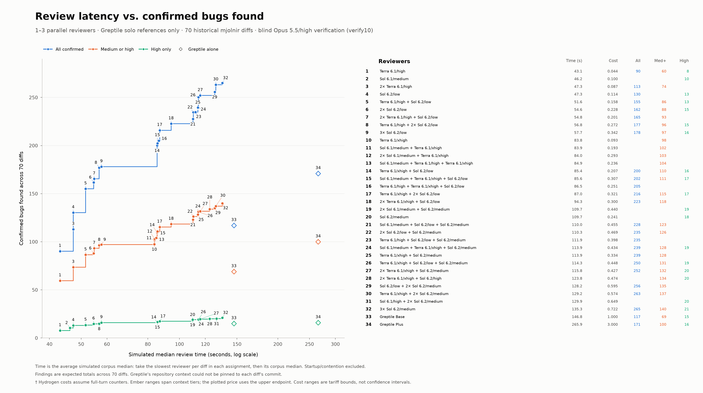
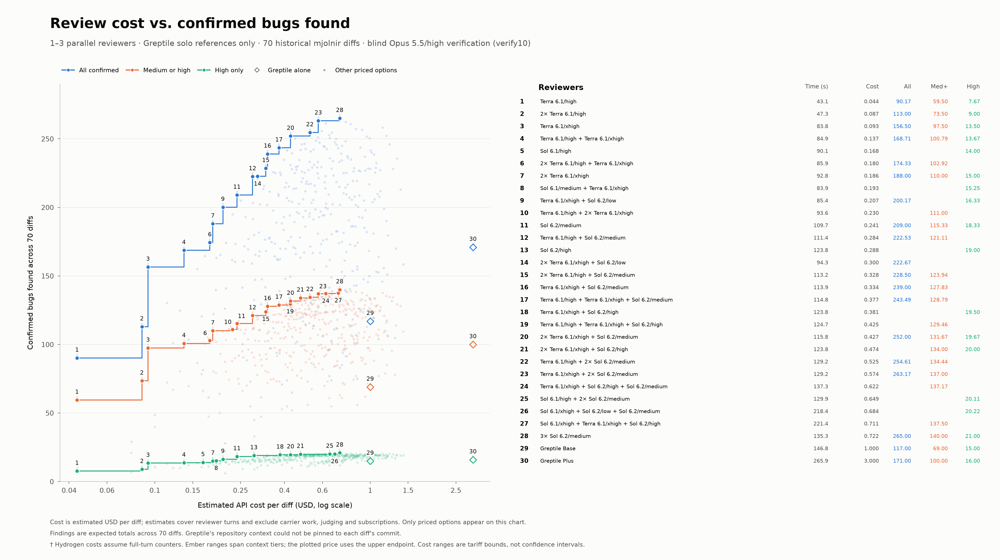
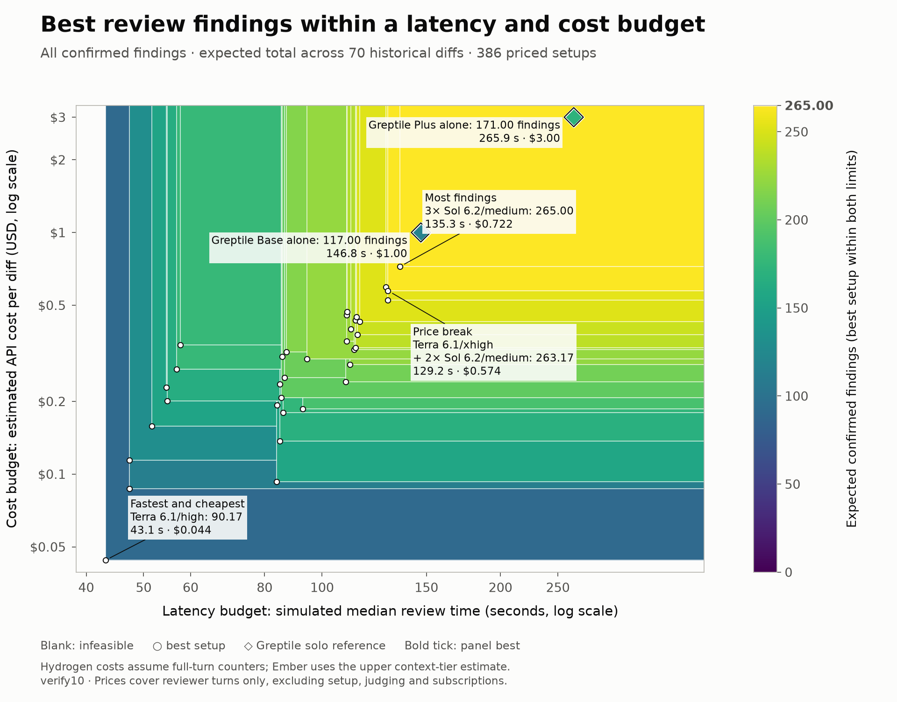
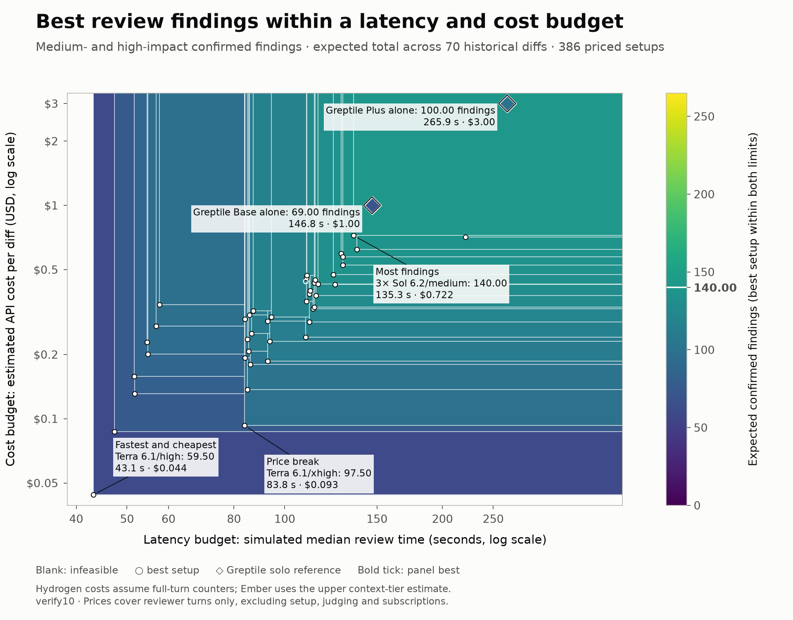

# Updated reviewer combination charts

These charts use the latest **verify10 Opus 5.5/high judgments**, including
Sol 6.2/high, and the verified Hydrogen, Kimi and Ember API-equivalent prices.
All **386 non-Greptile setups** now have price estimates. Greptile Base and Plus
remain solo references; all 183 Greptile combinations are excluded from plots
and budget optimization. DSF remains excluded from the primary 70-diff cohort,
and no DSF/medium point is invented.

None of the newly priced model families enters a cost frontier or wins a
latency-and-cost budget region under the stated conservative price assumptions.
They are included in the cost plot's background cloud and the budget lookup's
candidate set. The frontier keys show only setups that have a frontier mark in
at least one impact tier, plus the two Greptile references.

## Latency and cost frontiers





The keys retain **Time (s), Cost, All, Med+ and High**. Plot areas and key
headers are top-aligned, excluding the legend above the plot. Blank findings
cells mean that setup is off the corresponding impact frontier. The cost plot
has 30 keyed setups; the latency plot has 34. The full-precision cost frontiers
contain 17 all-impact, 20 medium+high and 16 high-only setups. Greptile is outside
frontier competition and uses diamonds; its repository context could not be
pinned to each diff's commit.

[Latency SVG](review-pareto-latency-findings.svg) ·
[Cost SVG](review-pareto-cost-findings.svg) ·
[All impact CSV](pareto.csv) · [Medium + high CSV](pareto-sev-high-medium.csv) ·
[High CSV](pareto-sev-high.csv)

## Findings within both budgets





[Interactive budget maps](review-opus-high-budget.html) ·
[Map data](review-opus-high-budget-data.json) ·
[Full caption](review-opus-high-budget-caption.txt)

Each map returns the most expected confirmed findings among setups whose time
and cost both fit the selected budget. The two maps share one color scale,
0 to 265. The best observed expected totals are **265 all-impact** and **140
medium+high** groups, both from three medium reviewers. These are descriptive
point estimates, not a claim of a significant advantage over nearby setups.
There are 35 all-impact and 44 medium+high setups that win or tie somewhere.

Region boundaries use the observed published thresholds, without hand-picked
budget breaks or interpolation. As in the preceding maps, latency is rounded
to 0.1 s, cost to $0.001 and findings to 0.01 for the budget lookup. The two
`budget-*.csv` files make that precision explicit. The main cost frontiers use
exact fractional findings and unrounded mean prices, so a small boundary or
tie difference between the maps and the frontier is expected.

## Versions without Greptile, with linear x-axes

[Cost frontier PNG](review-pareto-cost-findings-linear-no-greptile.png) ·
[Latency frontier PNG](review-pareto-latency-findings-linear-no-greptile.png) ·
[Combined Low+ budget PNG](review-opus-high-budget-low-plus-linear-no-greptile.png) ·
[Combined interactive HTML](review-opus-high-budget-low-plus-linear-no-greptile.html)

These versions remove Greptile's solo reference marks and key rows. The same
386 measured non-Greptile setups, findings, frontier flags and budget winners
remain. The cost and latency plots show only frontier points, with no
background cloud. All three x-axes are linear and start at zero. The combined
map keeps its logarithmic cost y-axis and shows Low+ findings (all confirmed impact
levels). Its time range includes every score-changing threshold, ending with
the 135.3-second threshold plus display padding; beyond that, additional time
cannot improve any cost budget's result.

```bash
bash "$W" plot_frontiers.py . --no-greptile --linear-x --frontier-only
bash "$W" export_low_plus_html.py --no-greptile --linear-x
```

SVG counterparts accompany the three PNGs. Validation checked all 119
frontier mark coordinates against the source CSVs (53 cost and 66 latency),
6,083 combined map pixels against brute-force budget lookup, and 2,475 interactive hover
positions plus click-pin/Escape behavior. The logarithmic default export was
also checked after adding the optional linear transform. These are chart
variants; no new reviews or judgments were run.

## Prices and measurement scope

The [same pricing overlay as the solo chart](../additional-model-prices.json)
supplies Hydrogen/medium ($0.212), Hydrogen/high ($0.659), Kimi/high ($0.434)
and Ember/xhigh ($0.026–$0.078) mean costs per single review.
[Rates, sources and token accounting](../README.md#newly-priced-models).

Hydrogen's historical prompt-response token counters have undeclared scope;
the chart assumes they cover the completed reviewer turn. Ember's per-request
context sizes were not retained, so its interval prices all tokens at the
under-200k versus over-200k tariff. **The plotted combinations and maps use
Ember's upper endpoint.** Keys show the corresponding lower/upper cost range
if an Ember-containing setup is keyed. These are tariff bounds, not confidence
intervals. Setups containing Hydrogen or Ember carry `†` when keyed.

Combination cost is a sum of configuration means. Each configuration's mean
first averages session cost within each diff, then averages those 70 diff
means. This matters for Terra/high, which has four retained samples on 11 diffs
and three elsewhere. Repeated-reviewer cost is linear in the number of sampled
reviewers even when sampling without replacement. Costs cover reviewer turns,
excluding startup/carriers, judging, subscriptions and taxes.

Findings count distinct confirmed groups, unioned across reviewers on each
diff and averaged over every valid assignment of distinct samples, then summed
across all 70 diffs. Cost-frontier membership is recomputed from those exact
fractions and exact rational costs at the retained input precision; legacy
session prices were already rounded to $0.0001. Latency observations and flags are retained
from the audited verify10 analysis. Time averages simulated corpus medians:
for each assignment, take the slowest reviewer on every diff, then the corpus
median. It excludes startup and contention. The underlying cohort has one high
sample versus three low/medium samples and the documented launch-protocol
confounds; the charts do not establish an effort-only causal effect.

## Reproduction and validation

Run from this directory:

```bash
python3 -B build_combo_prices.py
W=/mnt/optane/review-arms-20261113/sol-62-repeats/figure/render_frontiers_offline.sh
CH=/home/jonathan/.cache/ms-playwright/chromium_headless_shell-1234/chrome-headless-shell-linux64/chrome-headless-shell
bash "$W" plot_frontiers.py .
bash "$W" plot_budget_maps.py .
bash "$W" audit_budget_maps.py . --chrome "$CH" --scratch /tmp/review-combo-pricing-audit
node audit_budget_html.mjs . /tmp/review-combo-pricing-browser "$CH"
```

[build_combo_prices.py](build_combo_prices.py) reconstructs all 571 published
options from the 1,796-session scored tables and verifies their original
rounded yields. It checks every already priced combination against its old
price before adding the new configurations. [combo-pricing.json](combo-pricing.json)
records source hashes, configuration cost bounds and exact frontier members.
The original scoring tables and archived verify9 charts remain unchanged.

Validation compares exact cost-frontier dominance, every rendered key value
and flag, and budget surfaces against brute-force lookup. The image checks
compare PNG and browser-rendered SVG pixels. The browser audit checks the
actual hover and pin behavior, threshold edges, narrow regions, tied winners,
Greptile references and 320/375/1400-pixel viewports. The expanded candidate set
required the audits to sample against visible boundaries/markers rather than
all dominated candidates. Hover and click pin tests use the same integer CSS
pixel because Chrome rounds click coordinates. The retained failed-run logs
and targeted passing reruns are under
`/mnt/optane/review-arms-20261113/sol-62-high/combo-pricing/`.

Only the four requested PNGs are copied to Minastirith Downloads. The frontier
files use the existing friendly names `review-opus-high-findings-time.png` and
`review-opus-high-findings-cost.png`; the budget PNG basenames are unchanged.
