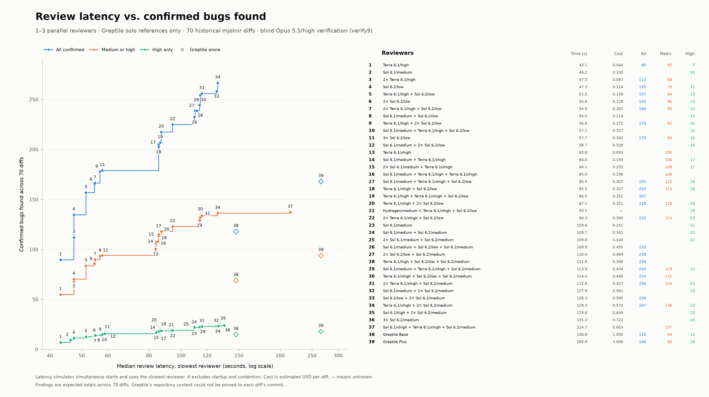
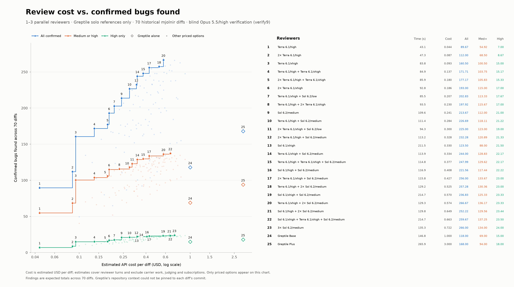
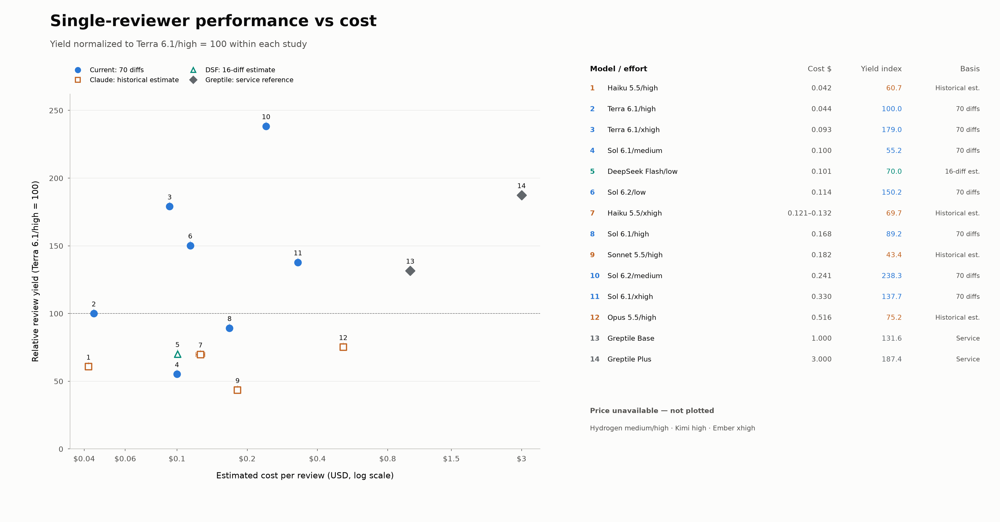
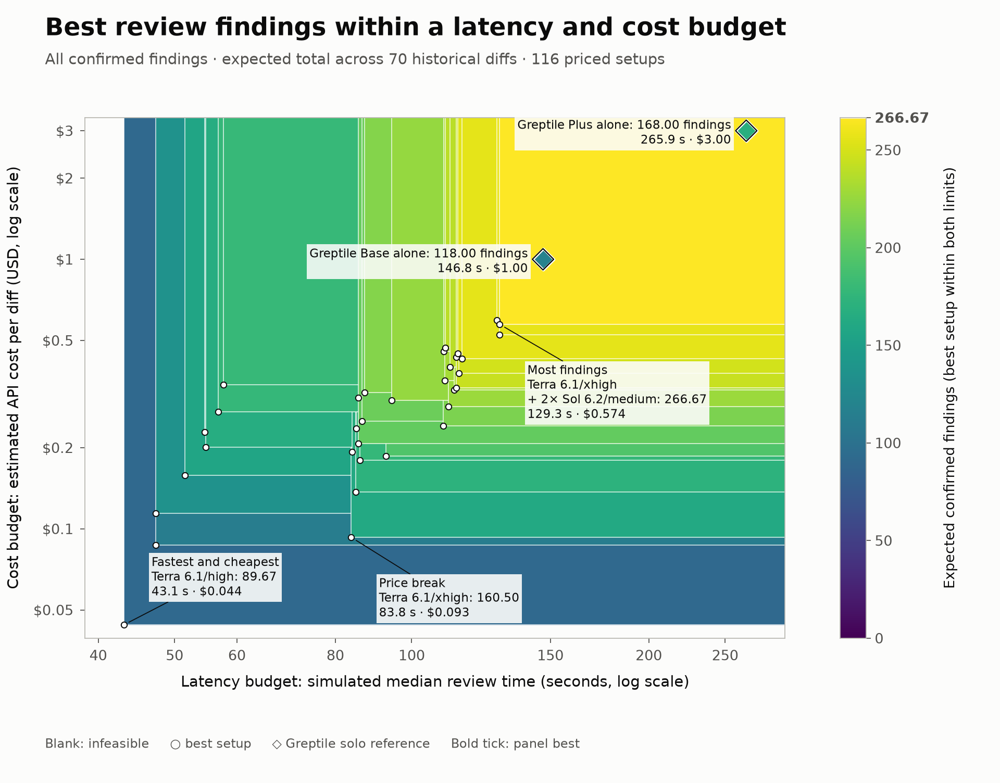
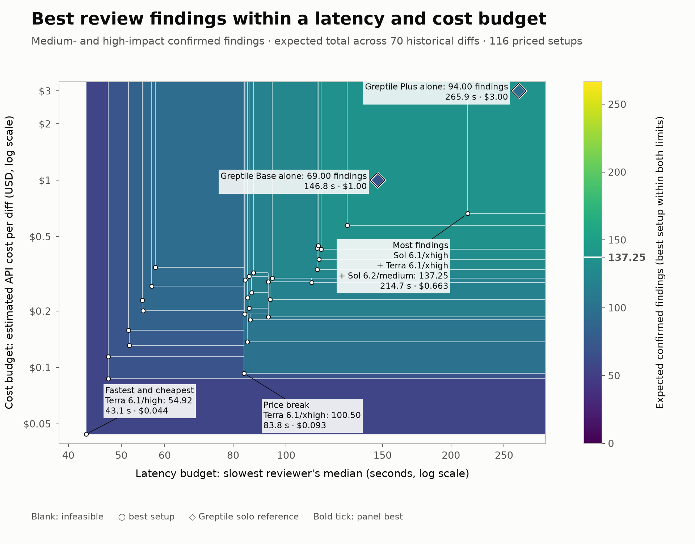

# Sol 6.2 reviewer repeats with Opus 5.5 high verification

On the same 70 diffs, one Sol 6.2 medium reviewer found **213.67** distinct
Opus-confirmed issues in expectation. One Sol 6.2 low reviewer found
**134.67**, and three independent low reviewers found **179.00** together.
Three medium reviewers reached **266.00**. The single-medium advantage over
three low reviews also held on medium and high impact findings, **112.00**
versus **94.00**.
The paired 95% intervals for that single-medium gain are **+21.67 to
+48.67** for all impact tiers and **+6.67 to +31.00** for medium and high.

Adding one Sol 6.2 medium reviewer to two Terra 6.1 high reviewers yielded
232.28 confirmed groups, compared with 166.44 for Sol 6.2 low and 121.17 for
Sol 6.1 medium in that slot.

## Findings by impact

L is Sol 6.2 low, M is Sol 6.2 medium, and T is Terra 6.1 high.

| Setup | Low | Medium | High | Medium + high | All confirmed |
|---|---:|---:|---:|---:|---:|
| L | 64.33 | 59.00 | 11.33 | 70.33 | 134.67 |
| L + L | 79.33 | 72.33 | 13.33 | 85.67 | 165.00 |
| L + L + L | 85.00 | 79.00 | 15.00 | 94.00 | 179.00 |
| M | 101.67 | 91.00 | 21.00 | 112.00 | 213.67 |
| M + M | 121.00 | 104.00 | 23.00 | 127.00 | 248.00 |
| M + M + M | 132.00 | 110.00 | 24.00 | 134.00 | 266.00 |
| L + M | 111.89 | 97.67 | 21.11 | 118.78 | 230.67 |
| L + L + M | 116.44 | 101.11 | 21.22 | 122.33 | 238.78 |
| L + M + M | 128.33 | 107.00 | 23.00 | 130.00 | 258.33 |
| T | 34.75 | 47.92 | 7.00 | 54.92 | 89.67 |
| T + T | 43.50 | 59.83 | 8.67 | 68.50 | 112.00 |
| T + T + T | 48.75 | 66.00 | 10.00 | 76.00 | 124.75 |
| L + T | 73.33 | 70.83 | 12.67 | 83.50 | 156.83 |
| M + T | 108.58 | 96.89 | 21.22 | 118.11 | 226.69 |
| L + L + T | 84.56 | 79.06 | 14.33 | 93.39 | 177.94 |
| L + M + T | 116.55 | 100.93 | 21.33 | 122.26 | 238.81 |
| M + M + T | 126.92 | 107.36 | 23.00 | 130.36 | 257.28 |
| L + T + T | 76.61 | 76.17 | 13.67 | 89.83 | 166.44 |
| M + T + T | 111.39 | 99.56 | 21.33 | 120.89 | 232.28 |
| Sol 6.1 medium | 9.00 | 31.00 | 9.50 | 40.50 | 49.50 |
| Sol 6.1 medium + T + T | 44.67 | 64.17 | 12.33 | 76.50 | 121.17 |

For each setup, take the union of confirmed groups for every valid
assignment of distinct reviewer sessions. Average those unions within
each diff, then sum the 70 diff averages. The two Sol 6.2 efforts each
have three samples per diff. Terra 6.1 high has three samples on 59 diffs
and four on 11. Sol 6.1 medium has two samples per diff.

### Paired contrasts

| Change | All confirmed, 95% paired interval | Medium + high, 95% paired interval |
|---|---:|---:|
| L to M | +79.00 (+60.67 to +99.33) | +41.67 (+27.00 to +58.67) |
| L to L + L | +30.33 (+22.67 to +38.67) | +15.33 (+10.00 to +21.00) |
| M to M + M | +34.33 (+26.33 to +43.00) | +15.00 (+9.33 to +21.67) |
| Sol 6.1 medium to L | +85.17 (+71.83 to +98.50) | +29.83 (+19.17 to +41.00) |
| Sol 6.1 medium to M | +164.17 (+136.00 to +194.33) | +71.50 (+52.00 to +93.67) |
| Sol 6.1 medium to L, with 2 × T | +45.28 (+34.58 to +56.39) | +13.33 (+6.19 to +21.58) |
| Sol 6.1 medium to M, with 2 × T | +111.11 (+89.58 to +133.19) | +44.39 (+30.39 to +60.08) |

[Exact counts](focus-counts.json) · [All paired comparisons](paired-comparisons.txt)

## Latency and usage

| Setup | Median latency (s) | Mean total tokens per diff | Estimated API cost per diff |
|---|---:|---:|---:|
| L | 47.3 | 294,546 | $0.114 |
| L + L | 54.6 | 589,091 | $0.228 |
| L + L + L | 57.7 | 883,637 | $0.342 |
| M | 109.6 | 735,622 | $0.241 |
| M + M | 127.9 | 1,471,244 | $0.481 |
| M + M + M | 135.3 | 2,206,866 | $0.722 |
| L + M | 110.1 | 1,030,167 | $0.355 |
| L + L + M | 110.4 | 1,324,713 | $0.469 |
| L + M + M | 128.3 | 1,765,789 | $0.595 |
| T | 43.1 | 244,964 | $0.044 |
| T + T | 47.3 | 489,928 | $0.087 |
| T + T + T | 51.7 | 734,891 | $0.131 |
| L + T + T | 54.8 | 784,473 | $0.201 |
| M + T + T | 113.2 | 1,225,549 | $0.328 |
| Sol 6.1 medium | 46.2 | 235,047 | $0.100 |
| Sol 6.1 medium + T + T | 54.3 | 724,975 | $0.187 |

Reviewer time runs from the captured prompt to completion. Each compound
latency models simultaneous starts using the slowest sampled reviewer,
then averages sampled corpus medians. It excludes startup and cannot
measure contention between the hypothetical teammates. Estimated API
costs cover reviewer turns and exclude carrier work, judging and
subscription charges. Gemini and Greptile lack tokens. Gemini, Kimi and
Ember lack prices, so options containing them remain eligible for the
latency frontier and stay outside the cost frontier.

### Latency and cost frontiers

Both charts use Opus 5.5/high verification across 70 diffs. Greptile Base and
Plus are solo reference diamonds. Greptile's repository context could not be
pinned to each diff's commit. The frontiers and cost cloud omit all Greptile
combinations. Both keys show reviewer setup, time in seconds, estimated cost
in USD per diff, and findings for all, medium-plus and high impact. Times are
shown to one decimal place, costs to three decimals, and unknown prices use an
em dash in the latency key. Severity cells appear for audited frontier marks
and Greptile solo references; blanks mean the option is not on that tier's
frontier. The cost chart includes only priced options.

[Latency SVG](review-pareto-latency-findings.svg) · [Cost SVG](review-pareto-cost-findings.svg)

From this results directory, render both charts from the checked-in CSVs with
`python3 plot_frontiers.py .` using Matplotlib 3.11.2. The script uses the
audited frontier flags and checks that removing Greptile options cannot
promote an option. It does not recalculate frontier membership from rounded
coordinates.

The latency frontier compares findings with simulated median latency.
For all impact tiers, Terra 6.1 high anchors the fast end at **89.67**
findings and **43.1 s**. Three lows reach **179.00** at **57.7 s**.
Terra 6.1 xhigh plus two lows reaches **217.50** at **87.1 s**, exceeding
one medium's 213.67 at 109.6 s. Two Terra xhigh plus one medium reaches
**256.00** at **115.8 s** and **133.67** medium and high impact findings.

The separate cost frontier compares findings with mean estimated API cost
per diff for priced setups. One medium costs **$0.241** and lies on the
all-impact cost frontier. Three lows cost $0.342. Two Terra xhigh plus one
medium is on both frontiers for all impact and for medium and high impact
at **$0.427**. Terra xhigh plus two mediums reaches **266.67** all-impact
findings at **129.3 s** and **$0.574**. Three mediums reach 266.00
at 135.3 s and $0.722. The full tables include the configurations from the
historical frontier and retain the original per-configuration sample caps.

[All impact](pareto.csv) · [Medium and high](pareto-sev-high-medium.csv) ·
[High](pareto-sev-high.csv) · [Medium](pareto-sev-medium.csv) ·
[Low](pareto-sev-low.csv)

### Single-reviewer performance versus cost

Yield is normalized to Terra 6.1/high = 100 within each source study. Current
measurements use filled markers; historical Claude and partial-cohort DSF
estimates use hollow markers. These series count different source outcomes:

- **Current study:** the single-reviewer rows of [pareto.csv](pareto.csv), from
  the blinded Opus `verify9` round. Yield averages one reviewer's confirmed
  group count within each diff, then sums across all 70 diffs. Its denominator
  is the Terra 6.1/high total on those same 70 diffs. Costs are estimated
  reviewer-turn API costs; Greptile uses its per-review service prices.
- **Claude historical estimates:** the earlier **mr-boxington PR/revision
  reviewer study**, preserved as `reviewcharts/data.json`, `native.csv` and
  `README.txt`. Yield is the mean material-root total, deduplicated within each
  PR and pass across follow-up revisions. Its denominator is Terra 6.1/high's
  material-root total from that same historical cohort. Costs use the earlier
  study's initial-head review estimates with the requested five-minute cache
  normalization; they exclude follow-up review costs. Haiku/xhigh's horizontal
  range is a historical pricing bound, with its marker at the midpoint. These are historical
  proxies, not fresh Claude results on the current 70 diffs.
- **DSF/low estimate:** `verify9/sessions.csv`, `groups.csv` and
  `session_groups.csv` supply the DSF and control outcomes on the same 16
  covered diffs. Each matched-control estimate is DSF's 16-diff total times
  that control's 70-diff total divided by its total on the same 16 diffs; the
  chart uses the median of the reference-control estimates. The displayed
  index divides that estimated 70-diff yield by **current Terra/high on all
  70 diffs**, rather than taking the raw DSF16/Terra16 ratio. Cost scales the
  observed subset reviewer cost by matched-control workload cost ratios. Its
  study peak token rates were checked against the [DeepSeek pricing page](https://api-docs.deepseek.com/quick_start/pricing/).

The frozen local input table is
`/mnt/optane/review-arms-20261113/sol-62-repeats/figure/single-model-cost-inputs.json`.
It identifies the original historical bundle and its hash and contains the
historical rows, matched DSF calibration table and cost assumptions. The
companion `review-single-model-cost.csv` records each plotted value, raw yield,
baseline and source. These detailed inputs remain local. The local
`plot_single_model_cost.py` reproduces the chart from that snapshot and the
checked-in current CSVs. Corpus, grading and follow-up exposure differ between
studies; within-study normalization does not make this a controlled comparison.

### Budget maps

Each map answers one question: if a team may wait at most T seconds and spend
at most C dollars per diff, what is the most confirmed findings any measured
setup delivers? The color is that maximum, F(T,C), over the 116 priced
non-Greptile setups with latency at most T and cost at most C. F changes only at
setups' own latencies and costs, so the region edges are those observed values
(lower bound included, no interpolation or budget bins). White lines mark where
the best score changes. Blank means no priced setup fits both limits.

The two maps share one absolute color scale (0 to 266.67), so the medium + high
map, which peaks at 137.25, stays in the lower half of it. The 196 setups with
an unknown price are omitted, because an unknown price is not a free one, and so
are all Greptile combinations. Greptile Base and Plus appear as diamonds at
their own measured findings, latency and cost ($1.00 and $3.00 per diff); the
background beneath them is the optimization without Greptile. The axes extend
past the largest priced setup (230.4 s, $0.900) to include both diamonds, and
the last observed row and column continue to the edge. Setups are named as in
the frontier charts. White dots mark setups that are best at some budget. A
setup counts as best when it is in the tied best set of at least one budget
cell, which here is the same 34 (all) and 31 (medium + high) setups that no
other setup beats on latency, cost and findings. The labels name three
data-derived points: the fastest and cheapest setup, the most findings, and the
"price break", the vertex of the cost-versus-findings concave hull where cost
per added finding jumps most (Terra 6.1/xhigh in both maps). The price break
describes this option set only.

Cost covers reviewer turns only and excludes carrier work, judging and
subscriptions. Review time is simulated: reviewers start together, so each
sampled session assignment takes the slowest reviewer on every diff, and the
median of those times across diffs is averaged over many sampled assignments
(`pareto.py`). It excludes startup and contention. Findings are expected
confirmed totals over the 70 diffs under the current Opus 5.5/high judgments.
The CSVs hold rounded values, so equal scores are ties at that precision and
this is not an audited full-precision frontier. The CSV `frontier` flags do not
define membership on these maps.

[Interactive map](review-opus-high-budget.html) shows the winning setups, their
latency, cost and findings, and any ties on hover; click pins the tooltip.
[All SVG](review-opus-high-budget-all.svg) ·
[Medium + high SVG](review-opus-high-budget-medium-high.svg) ·
[Caption](review-opus-high-budget-caption.txt) ·
[Embedded data](review-opus-high-budget-data.json)

From this results directory, render the maps, the HTML and the caption with
`python3 plot_budget_maps.py .` using Matplotlib 3.11.2 (the same offline wrapper
as the frontier charts). Check them with `python3 audit_budget_maps.py .`, which
recomputes F(T,C) by brute force from the CSVs for every threshold cell, exact
edges, one float below each edge and 40,000 random budgets, then compares the
embedded data, the HTML rectangles and sampled PNG pixels. Add
`--chrome <chrome-headless-shell>` to rasterize the SVGs the same way. Then run
`node audit_budget_html.mjs . <scratch dir> <chrome-headless-shell>` to drive the
HTML in headless Chrome and compare real hover tooltips with brute force.

#### Audit utility follow-ups

The published artifacts passed serial, uninterrupted audits at the canonical
artifact path. Three audit-tool hardening items remain as explicit review
follow-ups:

- SIGINT or SIGTERM can bypass Node cleanup and leave the detached audit
  browser/profile behind. Signal-aware cancellation cleanup remains to be added.
- Concurrent Python audits in the same checkout share `.audit-app.js` for the
  syntax check. Invocation-local input remains to be added; run that audit
  serially until then.
- The Python `--chrome` SVG pixel check does not encode `#` or `?` in local
  paths. Use the canonical artifact path until it uses `Path.as_uri()`. The
  separate HTML browser audit already supports encoded local paths.

## Coverage and judging

The 280 new reviews preserved the original 140 Sol 6.2 samples, for 210
reviews at each effort. All 420 have matching completed usage, a prompt
clock, a stored handback, and observed Codex 0.170.0/ACP 1.15.1 on the same
image (`sha256:1f5469c1c7264c025668e465a852199bc165938f6e84e925303f4fb46ca5e0db`).
The original and repeat cohorts ran at different times. The 6.2 reviewers
used `codex3` on 407 turns and `codex2` on 13. Earlier frontier reviews
used earlier runtimes, so timing and usage are measurements of the saved
setups and cohorts.

The historical pool contributes 1,306 raw reviewer handbacks and 1,960
findings. Together with all Sol 6.2 reviews, the fresh round covers 1,726
reviewers and 3,304 raw findings. It retains all 408 zero-finding reviews
and the one diff with zero pooled findings. DeepSeek Flash low contributes
35 handbacks on 16 diffs to joint judging; its coverage excludes it from
the 70-diff frontier.

Opus 5.5 high judged the 69 diffs with findings in 35 blinded batches on
`claude4`, using the original Opus specification and pinned Git checkout.
Durable records attest `claude-opus-5-5` and the reported auxiliary
`claude-haiku-5-5` usage on every completed command, with fast and ultracode
off. Each raw finding appears in one group on its own diff. Opus returned
528 groups, of which it confirmed 342, judged 62 plausible, and rejected
124. The confirmed groups include 188 low, 130 medium and 24 high impact
groups. The fresh round uses the raw reviewer handbacks from the archived
cohorts and fresh judgments throughout.

Each batch has a single judge. Randomized IDs and mixed finding order hide
the source fields, although wording may suggest provenance. The 20,000
paired diff bootstrap resamples keep all reviewer assignments for a diff
together. Its intervals reflect diff-to-diff sampling variation conditional
on the saved handbacks and the judge's decisions. They leave uncertainty
from judge disagreement outside the interval.

## Agreement with earlier rounds

Compared at the individual raw finding level, the two Opus/high rounds
agree on the verdict for **89.0%** of 1,928 shared findings (83.7% severity
agreement where both rounds kept the finding). Neon/medium in verify8 and
Opus/high in verify9 agree on **87.1%** of 881 shared findings (56.2% severity
agreement where both kept the finding).
[Earlier Opus comparison](consistency-vs-verify5.json) ·
[Earlier Neon comparison](consistency-vs-verify8.json)

These totals use identical reviewer session IDs across rounds. O and P each
contain the original single run per diff. E averages the same two Sol 6.1
medium runs on each diff.

| Same reviewer sessions | Round | Low | Medium | High | Medium + high | All confirmed |
|---|---|---:|---:|---:|---:|---:|
| E · Sol 6.1 medium | Neon verify8 | 1.50 | 34.00 | 14.50 | 48.50 | 50.00 |
| E · Sol 6.1 medium | Opus verify9 | 9.00 | 31.00 | 9.50 | 40.50 | 49.50 |
| P · original Sol 6.2 low | Neon verify8 | 30.00 | 101.00 | 24.00 | 125.00 | 155.00 |
| P · original Sol 6.2 low | Opus verify9 | 63.00 | 57.00 | 11.00 | 68.00 | 131.00 |
| O · original Sol 6.2 medium | Neon verify8 | 55.00 | 164.00 | 37.00 | 201.00 | 256.00 |
| O · original Sol 6.2 medium | Opus verify9 | 100.00 | 96.00 | 20.00 | 116.00 | 216.00 |

The main tables above use all three samples per Sol 6.2 effort. The archived
judgment comparison uses a fixed reviewer sample, but the two judge rounds
had different finding pools and deduplicated them independently. The differences
describe the two rounds and combine changes in grouping, pool and judging.

[Reproduction](reproduction.md) · [Scoring coverage](score.json) ·
[Reviewer usage by arm](reviewer-usage-by-arm.json) ·
[Matched reviewer-session counts](same-session-counts.json)
